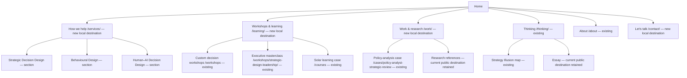

# Customer-centric navigation strategy

**Recommendation [P]: keep the editorial visual system and introduce a small, stable navigation hierarchy, supported by entry links written around customer problems.** Give commissioned work, executive/team learning and independently accessible resources distinct next steps.

Recommended primary navigation:

**How we help · Workshops & learning · Work & research · Thinking · About · Let’s talk**

This is a strategy for a future implementation. No application changes are included. All new routes, labels and content examples below are proposals.

## 1. Diagnosis and intended outcome

The existing site has substantive, distinctive material: three clearly articulated capabilities, a meaningful decision exercise, an executive programme with concrete outputs, a usable self-paced learning case, published research and a qualified case account. Its shared shell, mobile menu, accessible controls and fallbacks already work in the checked states.

The opportunity is to connect that material more directly to a visitor’s purpose:

**“This is my situation” → “This is the relevant support or resource” → “This is why I should consider it” → “This is the next step available to me.”**

Three observed gaps inform this recommendation:

1. All three capability cards share one onward workshop link, despite describing strategic, behavioural and Human–AI work. [Audit F03](AUDIT.md#3-findings-and-implications).
2. Learning and contact actions have different meanings: open resources, enquire about a module, discuss an executive day, or launch an email application. Their distinctions are not always made early. [F06–F10](AUDIT.md#3-findings-and-implications).
3. Work is a homepage anchor, while research and learning links can transfer visitors into another public navigation shell. [F04/F13](AUDIT.md#3-findings-and-implications).

[I] These may increase the interpretation required of unfamiliar visitors. They are not measured conversion losses. Validate the proposed labels and journeys before making claims about commercial improvement.

Preserve the practice’s positioning. Strategic Decision Design, Behavioural Design and Human–AI Decision Design remain the disciplines. AI supports relevant decisions; it does not become the whole business. The E–P–I–A–S curriculum remains specific to the executive programme.

## 2. Navigation approaches considered

The comparison is an expert assessment [I/P], not a scored customer study.

| Approach | Structure | Strengths | Trade-offs |
| --- | --- | --- | --- |
| A. Refine the existing structure | Keep Practice, Work, Thinking, Workshops, Courses, About; clarify labels and add contextual links | Lowest structural change; known workshop/course visitors retain direct header links; works with existing routes | Keeps two homepage-anchor destinations and separates adjacent learning formats; broad service discovery still relies on in-page interpretation |
| B. Group destinations and add problem-led entry links | How we help; Workshops & learning; Work & research; Thinking; About; Let’s talk | Represents the practice’s breadth; gives each destination a clear role; preserves direct child URLs; makes self-paced and team learning comparable without inventing a catalogue | Needs four useful local destination pages; a known workshop visitor may take one additional header-navigation step; grouped labels need first-click testing |
| C. Organise the entire header by customer problems | For example: Resolve priorities; Understand behaviour; Design Human–AI decisions; Develop capability | Immediate problem recognition; closely tied to customer questions | Overlapping needs make classification difficult; long labels crowd the header/mobile menu; stable cases, learning and credibility become harder to find |

**Select B, with C used inside the homepage and How we help page.** It gives customers stable places to find things and plain-language shortcuts into those places. It avoids forcing every visitor into a persona or making the whole global menu an interpretation of their problem.

Retain A as the lower-change alternative if testing shows the grouped learning label materially reduces workshop discovery. The recommendation is reasoned, not treated as a proven preference.

## 3. Target sitemap and destination roles

The diagram is proposed. “New local destination” means a future Astro page; it does not assert that the corresponding path is unused on the deployed legacy site.

### Header

Five plain text destination links and the current Let’s talk pill. Keep the single-line wordmark, compact control scale and restrained header footprint. Use one consistent destination order across desktop and mobile.

The learning landing page must show its actual options immediately: custom workshops, the executive programme, and the solar case. It must not become a long introduction that adds another discovery obstacle.

Keep direct child links in contextual navigation and the footer. A visitor who already knows the workshop or course should not have to traverse unrelated brand narrative.

### Mobile menu

Preserve the current native full-viewport dialog, close control, Escape, focus return and scroll containment. Use the same five primary links and contact action.

Start with direct links to the grouped destinations. Do not add a nested mega-menu by default. Test portrait, short landscape, keyboard and text enlargement. If visitors need direct child links in the menu, add a small, clearly grouped list only after checking that it remains usable at short heights.

Current category visibility should persist on descendant pages. Keep exact-page indication accurate, and use a separate ancestor treatment/breadcrumb for the broader category. Do not falsely mark a parent link as the exact current page.

### Footer and contextual navigation

Keep the large formation invitation and readable reversed identity. Arrange supporting links by purpose:

| Group | Proposed destinations |
| --- | --- |
| Get support | How we help; Strategic Decision Design; Behavioural Design; Human–AI Decision Design; Contact |
| Workshops & learning | Custom decision workshops; Executive masterclass; Solar learning case |
| Evidence & thinking | Work & research; Research references; Thinking |
| Practice | About; professional biography; email; Privacy; Terms |

Use compact editorial lists within the existing grid. A small inventory does not need search, filters or a large multi-level taxonomy.

On offering pages, provide a category return link, a short section navigation and a contextual next step. On case/research pages, link to the relevant capability as well as the evidence index.

## 4. Label-and-destination decisions

All targets marked “new” or “planned” must be created/validated in a separately authorised implementation. Existing URLs remain available.

| Current label / destination | Proposed label / destination [P] | Customer purpose and rationale |
| --- | --- | --- |
| Practice → /#practice | How we help → /services/ (new) | Understand the available kinds of support without first interpreting “practice”; retain the capability cards and current anchor as useful entry points |
| Work → /#evidence; footer Work & research → same | Work & research → /work/ (new) | Provide a consistent, linkable place for the actual case account and research; no inflated portfolio implied |
| Workshops → /workshops | Global Workshops & learning → /learning/ (new); contextual Custom decision workshops → /workshops (existing) | Compare formats; keep a direct path for a team bringing a live decision |
| Courses → /courses | Solar learning case → /courses beneath learning | Describe the actual current offering; preserve the existing route and cohort option |
| Five-day executive masterclass → current programme route | Strategic Design Leadership in the Age of AI → same route, with “Five standalone working days” descriptor | Identify the actual programme and format without requiring familiarity with its stage names |
| Thinking → /thinking/ | Thinking → same route | Preserve the current maps/essays identity; add a small “Decision maps & essays” descriptor on the destination |
| About → /about | About → same route | Practitioner, principles and credibility remain straightforward |
| Let’s talk → plain mailto | Let’s talk → /contact/ (new); visible email remains | A consistent on-site start with a clear email alternative; preserve the pill’s visual treatment |
| Explore decision workshops beneath all capabilities | Capability-specific links → /services/#strategic-decision-design, #behavioural-design, #human-ai-decision-design (planned) | Match the onward destination to the card the visitor is reading |
| Commission Module 05 Cohort | Discuss this module for your team → contact with course/module context (planned) | Express the next action in familiar language; preserve the existing module handoff and keep the current route’s form working during transition |
| Open module in live course | Open this learning module → existing corresponding public module | Distinguish learning access from a sales enquiry |
| A decision in practice | Read the policy-analysis case account → existing case | Make the nature of the evidence explicit |
| Research & references | Research & references → existing public research URL until a deliberate migration | Preserve a working destination and its citation trail |

Keep spelling, case and punctuation consistent between header, mobile menu, footer and page breadcrumbs. The uppercase public /Courses/ tree and lowercase local /courses route are separate current destinations; do not combine or redirect them casually.

## 5. Proposed customer journeys

These audience groups and triggers are hypotheses [I] derived from existing offerings. No demographic segmentation or customer research is implied.

| Visitor intent / trigger [I] | Questions to answer | Entry → relevant support [P] | Evidence before commitment | Appropriate next step |
| --- | --- | --- | --- | --- |
| Leader facing competing priorities | What is the decision? What trade-offs will be examined? Is a workshop or advisory conversation suitable? | Home problem link or How we help → Strategic Decision Design → custom workshop where a group decision is involved | Qualified policy case; process and concrete decision outputs | Discuss the decision, with capability and originating page retained |
| Team seeking behavioural research | Why is an agreed action not happening? Do we need research before an intervention? | Problem link → Behavioural Design section | Cookstove research, including the qualified finding and methods | Discuss a behavioural question; do not automatically channel into a workshop |
| Owner introducing AI into consequential work | Who decides, reviews and can stop an action? What responsibility remains with people? | How we help → Human–AI Decision Design | Specific authority/review output; relevant thinking, clearly distinguished from empirical outcome evidence | Discuss decision authority and review; no promise to build an AI platform |
| Manager arranging team learning | Which format fits our question, people and time? Can a day stand alone? | Workshops & learning → custom workshop, executive programme or facilitated solar-case cohort | Actual agenda, participant fit, deliverables and practitioner evidence | Discuss the selected team engagement, with programme/day/module retained |
| Individual wanting to learn | Can I start now? What tools and prior knowledge do I need? Is attendance actually available? | Learning → solar case/resources; executive programme exploration where relevant | Stated 65–80 minute case, beginner spreadsheet guidance and actual output | Open the existing material. For unconfirmed public programme attendance, “Ask about attending” or “Register interest” only if a real handling process is established |
| Visitor assessing credibility or returning to contact | Has relevant work been done? Who will I work with? How do I reach them? | Work & research / About / Thinking → relevant evidence → Contact | Source-labelled research, case-account qualification, biography | Contextual conversation or direct email; no mandatory course detour |

Do not require everyone to choose “individual” or “enterprise” before seeing content. Offer those distinctions at the point where they change the next action.

### Journey rules

- Each offering needs a visible explanation of who it is for, the situation it addresses, a concrete output, available format/status and next step.
- The organisational problem should introduce the discipline. Keep the accurate discipline name alongside it.
- A resource-opening action must stay distinct from an enquiry or booking.
- A visitor can inspect all programme days without selecting a maturity level or passing through a prescribed ladder.
- The exercise remains fictional and optional. Do not turn its two choices into a lead score or automated service diagnosis.
- Keep the selected programme/day/module visible at the start of the enquiry, not only in a hidden field or email subject.
- Add shareable programme-day state in a future enhancement. Existing session IDs offer a starting point, but opening/restoring a day from a URL and browser history needs explicit implementation and testing.

## 6. Proposed homepage sequence

[P] Change the information order while preserving the current visual grammar. The exact opening copy should be tested for comprehension rather than assumed to outperform the existing headline.

| Sequence | Customer question / content | Existing visual foundation and proposed action |
| --- | --- | --- |
| 1. Editorial proposition | “Is this relevant to my situation?” Retain More possibilities. Harder choices. and the explanation of consequential choices | Same display typography, deliberate lines, yellow signal and restrained supporting copy. Add clear routes to How we help and Workshops & learning; keep global Let’s talk accessible |
| 2. Brief problem-led entry links | “Where should I start?” Competing priorities; behaviour that resists change; accountability around AI | A short editorial link list using existing type and rules, not another animated card grid. Link to the three service sections. No forced persona selection |
| 3. Selected evidence | “Why should I consider this practice?” One concise case account and a research reference with its limitation | Reuse the evidence-spread language. Preserve the distinction between a reported result and research findings. Link to full evidence and About |
| 4. Three capability cards | “What does the work involve?” Current disciplines, questions and outputs | Preserve the black cards, original sculpture, scale, disclosures and controls. Add a visible, specific onward link for each capability |
| 5. Workshops and learning invitation | “Can I work through this with a team or start learning?” Present the three real formats with audience/output/status | Use a change of editorial rhythm: statement plus compact offering rows. Link directly to custom workshops, the executive programme and the solar case |
| 6. Optional Find Formation demonstration | “How does this practice make trade-offs visible?” | Preserve angular shapes, two-choice interaction, explanatory notes and static example. Frame as “Try a decision exercise”; offer a clear link onward or past it |
| 7. Thinking and instruments | “How do you think about these issues?” | Retain the strategic map and essay as optional depth. Give each a descriptive destination and a relevant next step |
| 8. Decision invitation and footer | “What should I do next?” | Preserve the yellow closing scene and large footer invitation. Use the consistent Contact destination with email alternative |

Moving the exercise later is a proposal about task order, not a judgement that it lacks value. Compare this order with a version retaining the exercise near the top but adding earlier routing. The key test is whether visitors can find the right support efficiently while still recognising the brand.

Do not fill every screen with CTAs. Give each scene one main purpose and one relevant onward route. Keep navigation available to visitors who already know what they need.

## 7. Key page content outlines

### How we help — new local destination

1. A short editorial proposition stating the practice and situations it helps examine.
2. Three plain-language problem links paired with the actual disciplines.
3. For each capability: customer situation; question to resolve; what the work may involve within the existing scope; concrete output; relevant proof; contextual enquiry.
4. Distinguish engagement format from discipline: a workshop can support a strategic decision, but is not the only route for behavioural research or advisory work.
5. A short “Not sure where to start?” invitation to describe the decision.

Use one substantial page with three clear sections initially. The current evidence does not justify three thin service microsites or a large industry taxonomy.

### Workshops & learning — new local overview

1. An opening that distinguishes working on a live decision from developing decision capability.
2. Three actual options: custom decision workshops, the five-day executive programme, and the solar learning case.
3. For each: audience, question/output, known format, access/enquiry status and one next action.
4. Two contextual routes: accessible material for individual exploration and a conversation about team learning.
5. A concise selection aid using actual differences; no filters around three options.
6. A contact alternative when the visitor’s needs cross formats.

Do not call this an academy unless that is a deliberate, supported business decision.

### Custom decision workshops — existing /workshops

1. The team’s situation, workshop purpose and a contextual enquiry near the opening.
2. Suitable questions drawn from existing competing priorities, AI accountability and agreement-without-action content.
3. Outputs: framed decision/constraints, review rights where relevant, ownership and review.
4. Existing three-part process.
5. Facilitation and scope information that can be confirmed; no invented length, location or fixed price.
6. Relevant evidence and practitioner context.
7. Brief practical questions and an enquiry with workshop intent retained.
8. A clearly secondary link to the structured executive programme.

### Executive programme — existing route

1. Programme name; intended executive audience; five standalone working days; concise practical status and an appropriate next step.
2. The five decision questions and executive outputs, using the actual programme data.
3. Existing formation, optional previews, selected-day expansion and direct progression.
4. A visible choice between discussing one day and the full programme.
5. Relevant facilitator/authority material; no unsupported programme success claims.
6. Practical details: confirm dates, delivery modes, participation model and pricing before publishing them.
7. Agenda and preparation questions; do not assume five consecutive days.
8. Contextual enquiry with the chosen day/programme visible.

For individual interest where public attendance is unconfirmed, state that availability must be discussed. Do not show “Book a seat”, remaining places or a guarantee.

### Solar learning case — existing /courses

1. Identify the actual case by name and its purpose, with the existing 65–80 minute scope and spreadsheet guidance.
2. Early primary action: Open the learning case. Secondary: Discuss a team session.
3. What the learner will produce and how to get the workbook.
4. Existing six-module explorer and optional detail.
5. Downloads with format, purpose, host and clear action.
6. Separate the self-paced material from a commissioned cohort; preserve the module-specific handoff.
7. A short audience/prerequisite statement and contextual enquiry for team use.

The financial values in the fictional case are inputs to learning, not course fees. Do not treat the existing live resource as proof of a confirmed paid or accredited course offer.

### Work & research — new local evidence destination

1. Explain what evidence is available and how to read it.
2. Present the existing policy-analysis case explicitly as a case account.
3. Present cookstove research with its actual question, method, qualified finding and source.
4. Link to the working reference archive.
5. Connect each item to the capability it informs; avoid suggesting it proves outcomes for every service.
6. Add a relevant next step after the full case/research narrative.
7. Retain print access and citation trails.

### Contact — new local destination

1. A neutral, concise invitation such as “What needs deciding?” with a visible direct email alternative.
2. Show the enquiry context: capability, programme/day or course/module, when supplied.
3. Proposed minimum required information: name, email and a useful question/context. Make organisation, team size and area of interest optional or context-dependent unless the business establishes a clear need.
4. Let visitors express individual programme interest without having to invent a company or team.
5. Preserve clear labels, validation, pending/confirmation/error feedback, retained input and email fallback.
6. Explain the next step truthfully. Do not promise a response time or scheduled call without an operational commitment.

The existing form already supports error recovery and module context in the tested mocks. Reuse those strengths. During any future migration, keep existing enquiry anchors operational and avoid losing context between routes.

## 8. CTA and handoff strategy

These are copy/destination proposals, not implemented controls.

| Context | Primary action | Destination / context | Secondary action |
| --- | --- | --- | --- |
| Global header | Let’s talk | Proposed /contact/ | Visible email on Contact and footer |
| Homepage opening | Explore how we can help | Proposed /services/ | Workshops & learning → proposed /learning/ |
| Strategic capability | Discuss a strategic decision | Contact with Strategic Decision Design + origin | Relevant case |
| Behavioural capability | Discuss a behavioural question | Contact with Behavioural Design + origin | Research evidence |
| Human–AI capability | Discuss decision authority | Contact with Human–AI Decision Design + origin | Relevant thinking; label it as thinking |
| Custom workshop | Discuss a workshop | Contact or maintained workshop form with selected intent | How the workshop works |
| Programme | Discuss the programme | Contact with programme title | Explore the five days |
| Selected programme day | Discuss this day | Contact with programme title, day number, stage and question | Return to all five days |
| Individual interest without a confirmed cohort | Ask about attending | Contact with programme and individual-interest context | Explore the agenda |
| Solar case | Open the learning case | Existing branded public learning entry, subject to host decision | Discuss a team session |
| Selected course module | Open this learning module | Existing selected module URL | Discuss this module for your team, preserving module ID/title |
| Resource row | Open/download the named file | Existing exact URL and format | No required lead form |
| Case account | Discuss a similar decision | Contact with originating case | All work & research |
| Decision map | Explore support for this question | Relevant Strategic Decision Design section | All thinking |

Retain Let’s talk as the brand’s global contact phrase. Specific page-level actions can explain the subject. Avoid buttons labelled “Book”, “Reserve”, “Buy” or “Schedule” when the destination only opens an enquiry.

A future contact handoff should carry only the necessary offering context and origin. Avoid placing personal information or the visitor’s written decision in a URL. Keep the context visible and editable. Do not send exercise selections: Find Formation currently promises that its information is not saved or sent.

The current programme mail subjects and course-module context are useful precedents. A shared contact route should preserve that specificity rather than replace every action with a generic blank form.

## 9. Visual and interaction preservation plan

Source authority remains [the definitive design direction](../design-reference/DEFINITIVE_DIRECTION.md). The strategy changes information order and connectivity; it does not authorise a second visual system.

| Structural proposal | Existing visual/interaction specification to retain |
| --- | --- |
| Clearer navigation labels and groups | Current single-line THE SPOTTED APE identity; self-hosted Archivo; 16px restrained navigation role; 20/40px margins; same desktop/mobile destination order |
| New destination openings | Existing PageIntro patterns and content-sensitive type roles; 98px long-title role at 1440px; deliberate wrapping; do not force long copy into the largest display size |
| Earlier problem-led routes | Quiet editorial text links and structural rules; existing body/lead roles around 19.104/25.184px at 1440px; no new chip taxonomy or dashboard chrome |
| Capability onward links | Existing black 20px-radius cards, original SVG sculpture, 77.856px card headings and native Questions & outcomes disclosures; keep link labels visible without hover |
| Reordered homepage | Existing scene changes, white/black fields, yellow commitment accent and generous spacing; retain 174.944px home display and 145.648px large section roles where content fits |
| Learning overview | Existing statement/link-rail and editorial-row language; distinct outcomes and actions; avoid uniformly boxed marketplace tiles |
| Evidence destination | Existing research spread, source notes and case article hierarchy; preserve qualification, readable measure and print behaviour |
| Contact destination | Existing form controls, labels/status/fallback pattern; consistent question framing; no new modal form by default |
| Formation and programme | Existing angular illustration, direct shape interaction, preview/selected distinction, 200ms colour response, keyboard/touch and native fallbacks |
| Practice sequence | Existing native-scroll desktop progression, direct controls, mobile swipe/scroll and reduced-motion vertical stack; direct task links do not depend on completing the sequence |
| Contact pill | Centred, arrow-free, borderless Let’s talk treatment; 700ms pointer-origin circle reveal using the measured easing; current fringe fix and keyboard focus retained |
| Optional reveal/movement | Existing 800ms entrance role, 600ms card-art response and 300ms disclosure response; essential content available without animation |

Colour remains near-black #0D0B0A, white #FFFFFF and signal yellow #FFFF00, with supporting neutral greys. Typography stays predominantly Archivo 600 for display and 400 for reading; sparse JetBrains labels remain supportive. No serif, warm Namib palette, magenta accent or copied Huge assets.

Use the existing 4/8/12-column boundaries, 8/16px gutters and 1800px content cap. At small widths, maintain readable body copy, natural vertical flow and practical action placement. Improving access does not require shrinking every headline or removing generous space.

## 10. Prioritised future roadmap

This is sequencing guidance only. No route, component, integration or copy change has been implemented.

| Priority | Future work | Dependency / acceptance |
| --- | --- | --- |
| P0 — Content truth | Create a concise offering inventory: custom services, workshops, executive days/programme, existing learning resources; confirm what can be accessed or enquired about now | Owner resolves individual-attendance status, delivery facts and primary course host; unknown dates/prices remain unpublished |
| P0 — Resource continuity | Record the linked public research/article/course trees and authoritative content ownership | Their working URLs must survive a future deployment or have an explicit migration/redirect plan; no blanket case-folding of /Courses/ into /courses |
| P1 — Contact and support routing | Define useful How we help and Contact destinations; add capability-specific onward paths; agree context labels | Relevant support available within two navigation selections from primary entry; contextual enquiries retain the selected offer |
| P1 — Learning and evidence organisation | Create useful Learning and Work & research destinations from actual existing material; connect current child URLs | Hubs expose their real options near the opening; no empty catalogue or placeholder service pages |
| P1 — Homepage order and copy | Add early problem routes and selected proof; compare exercise placement; expose self-paced learning access | Comprehension/first-click review retains the brand while reducing incorrect-route choices |
| P2 — Orientation and state | Consistent ancestor/breadcrumb cues, programme-day deep links, back/reload restoration, context at the enquiry opening | Direct loading and browser history restore the intended day; keyboard focus and reduced motion remain correct |
| P2 — Cross-boundary continuity | Make public-resource handoffs and return routes clear; align owned shells when a separate project scope permits | Learning/resource journeys remain usable across hosts; no loss of files, citations or current links |
| P2 — Validation and measurement | Run the task-based validation below and establish a baseline before optimising | Report observed results and limitations; do not infer conversion improvement from click counts |
| Conditional P3 — Public attendance / commerce | Only if the practice chooses to sell a real public offer: define availability, price, terms, payment, capacity, confirmation and fulfilment | Commercial operation is ready and truthful; decide whether direct checkout is sufficient before considering a cart |

New destination pages should reuse the current Astro shell and components in a future implementation. A new client framework, animation library, search system, CMS migration or commerce dependency is not required to validate this architecture.

## 11. Validation plan

### A. Content and label review

Use the factual inventory to check every offering label, audience statement and practical claim. Review the distinction between commissioned work, individually accessible learning and unconfirmed attendance.

Run a first-click/tree exercise comparing A and B. Recruit approximately ten relevant participants across five principal intent groups, aiming for two from each: strategic leaders; teams seeking behavioural or Human–AI support; team-learning leads; individual learners; and visitors evaluating evidence/practitioner fit. These are recruitment hypotheses, not established customer segments. This is directional research, not a population-level estimate.

Give all participants the same short first-click tasks, counterbalanced in order. Give each participant two deeper journeys matched to their likely needs.

| Task | Expected destination under B | What to observe |
| --- | --- | --- |
| “Our priorities compete for the same resources. Find help with the decision.” | How we help → Strategic Decision Design | Correct first route; ability to explain the support |
| “We need to understand why people are not adopting an agreed change.” | How we help → Behavioural Design | Whether learning/workshop labels distract from research support |
| “We are introducing AI into important work and need to define human review.” | How we help → Human–AI Decision Design | Whether visitors can find decision-accountability support without interpreting it as a general AI agency |
| “Arrange a working session for an executive team.” | Workshops & learning → appropriate workshop/programme | Whether grouping makes known workshops harder to find |
| “Start the solar learning activity on your own.” | Learning → solar case → live resource | Whether a visitor is incorrectly sent to a team enquiry |
| “Find relevant work or research before contacting the practice.” | Work & research | Expectations about case evidence versus publications |
| “Discuss the customer-choice day of the executive programme.” | Programme → Day 02 → contextual enquiry | Day identity remains visible, including on mobile |

Proposed decision thresholds, to be agreed before testing:

- At least eight of ten correct first choices on each critical task.
- No critical task should repeatedly require backtracking because its destination is named unexpectedly.
- Participants can distinguish opening a resource from requesting an engagement.
- Team and individual learners can explain their available next action.
- Both compared structures retain an identifiable Spotted Ape aesthetic in review.

If B underperforms A for workshop discovery, adjust the grouped label or restore a direct workshop route. Do not defend a smaller menu solely because it has fewer links.

### B. Rendered journey acceptance in a future implementation

Check 390px mobile, 844 × 390 landscape, 1024px desktop breakpoint and 1440px desktop; add 320px and text enlargement for compact layouts.

Verify:

- Menu open/close, focus containment/return, visible current category and no clipped actions.
- Direct routes to support, programmes, resources and contact without completing an exercise or scroll sequence.
- Formation’s two-choice rule, optional previews and accurate static example.
- Practice-card direct controls, disclosures, native mobile scrolling and reduced-motion stack.
- Every programme day, direct day link, reload/back/forward, Escape and retained day context.
- All six course modules, keyboard selection, live-resource URLs and module-to-enquiry context.
- Contact required/optional fields match the stated intent; errors retain input and offer recovery.
- No-JavaScript navigation, native disclosures, usable links and forms.
- No unexpected horizontal overflow; important actions clear sticky navigation.
- Existing case print view, citations, resource file types and protected legacy/public URLs remain intact.

Mock enquiry responses as in this audit. Test delivery separately through the actual operational process only when expressly authorised. No real enquiry was sent here.

### C. Measurement after a separately approved release

Establish baseline and comparable post-change periods before claiming an improvement. Suggested measures:

| Measure | Meaning / limitation |
| --- | --- |
| Correct-route success in task tests | Direct evidence of findability for those participants; not a sales metric |
| Offering destination reached from an entry page | Indicates discovery; requires a defined eligible-session denominator |
| Live learning/resource opened | Indicates access intent; not completion or learning gain |
| Contextual enquiry started and accepted by the form endpoint | Shows progression; endpoint acceptance is not confirmed human receipt or qualified demand |
| Qualified enquiry by stated need | Requires manual outcome classification; compare quality as well as counts |
| Wrong-route recovery and repeated navigation backtracking in tests | Useful label/architecture signal; investigate rather than assume motive |

Do not log written enquiry content or personally identifiable details as navigation analytics. Do not instrument Find Formation choices under its current promise that information is not saved or sent. Avoid learning-completion, revenue or conversion forecasts without the relevant evidence.

## 12. Open business questions and assumptions

1. Is individual attendance on the executive programme offered, planned, or outside scope?
2. Are programmes usually commissioned as teams, standalone days, a connected progression, or a combination?
3. Which delivery modes, locations, preparation requirements and durations are confirmed?
4. Should any price be published, and what would it include? No current value is assumed.
5. Is follow-up support included in any offering? The blueprint’s coaching promise is not evidence.
6. Which biography, qualifications, case details and feedback may appear beside offers?
7. Which host is authoritative for the solar case, and who maintains its two public entry points?
8. What response commitment and enquiry-handling process can the practice sustain?
9. Which existing public research/article/course files must remain available across future publishing?
10. Are there analytics, enquiry-quality data or customer interviews that could change the audience assumptions?

Assumptions used for this strategy: the current local content accurately represents the practice’s intended positioning; the linked public resources remain part of its useful customer journeys; no public booking capability or commercial offer terms have been established by the supplied evidence.

## 13. Decision

[P] Proceed with a grouped, customer-oriented navigation concept and problem-led in-page routes. Keep the existing disciplines, substantive materials and expressive visual language. Make commissioned support easy to identify, learning access easy to start and enquiries specific to the visitor’s intent.

Validate the labels, resolve the limited business facts and protect resource continuity before a future implementation. Commerce remains conditional. The strategy ends here.
